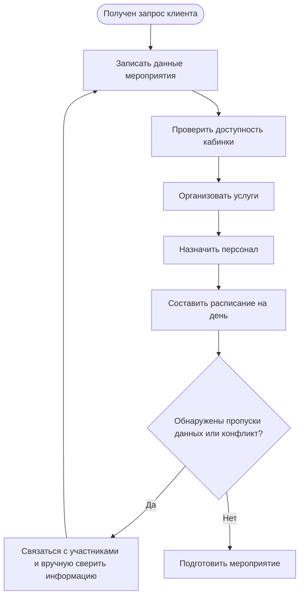
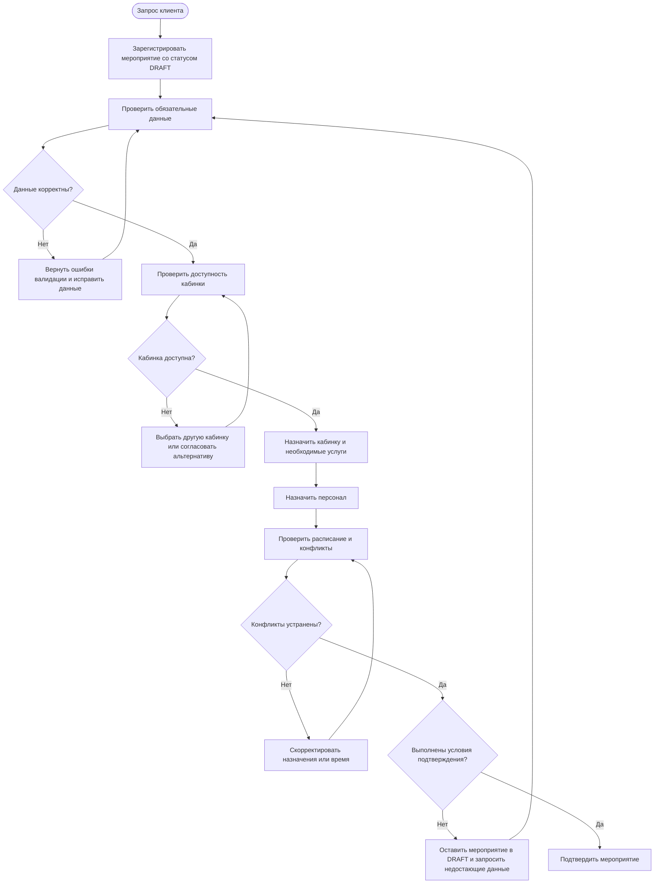
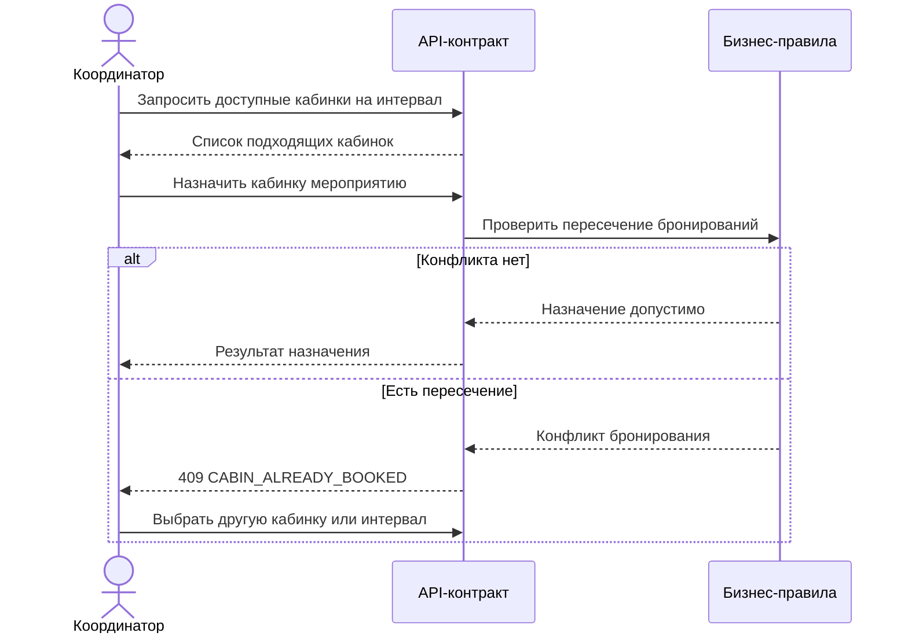
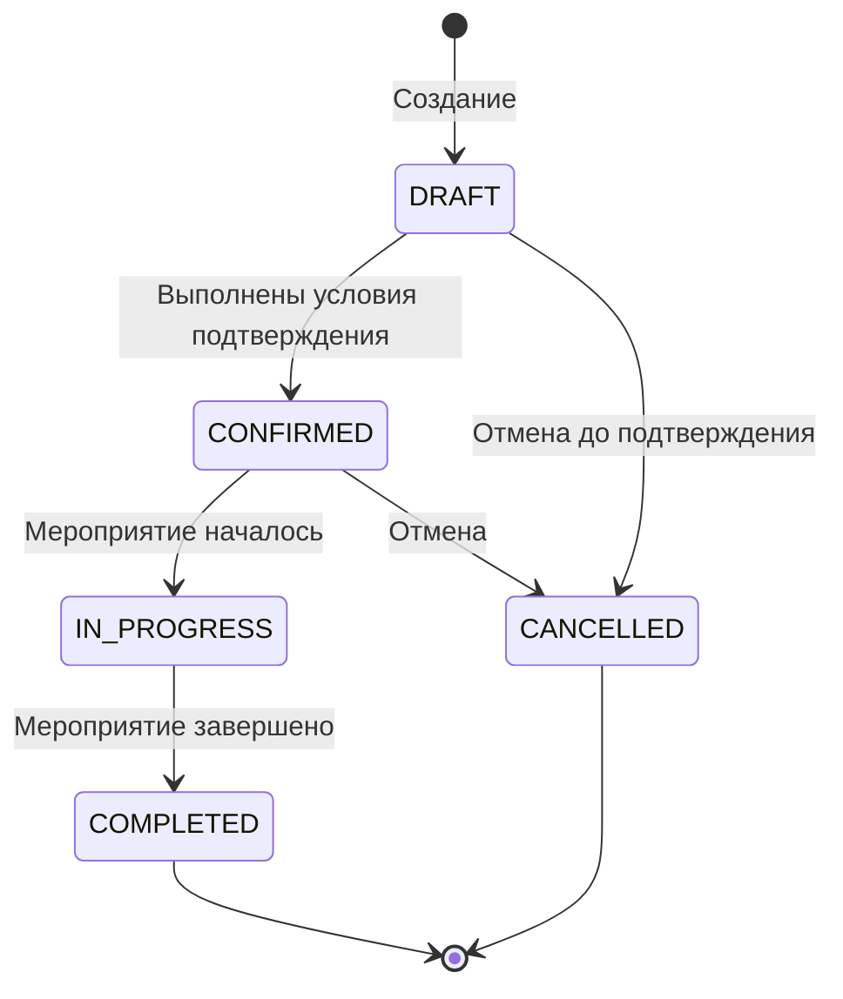

# Диаграммы бизнес-процессов и проектного решения

Диаграммы дополняют кейс бизнес-анализа из [`business-requirements.md`](business-requirements.md) и [`traceability.md`](traceability.md). AS-IS — **иллюстративная гипотеза**, а не подтверждённая модель реальной площадки. TO-BE — предлагаемая модель, требующая согласования с заинтересованными сторонами.

## 1. AS-IS — гипотеза текущего процесса

Предполагается, что текущая координация может требовать ручного сопоставления данных о мероприятиях, доступности кабинок, услугах, персонале и расписании. Перед тем как считать это фактическим AS-IS, модель нужно проверить интервью и наблюдением.

**Потенциальные проблемные места для проверки:** повторный ввод данных, несогласованность сведений, позднее обнаружение конфликтов и отсутствие единых критериев подтверждения бронирования. Это гипотезы, а не наблюдавшиеся факты.

## 2. TO-BE — предлагаемая целевая модель процесса

**Важно:** условия подтверждения, возможность назначать кабинку на этапе создания и правила обработки конфликтов должны быть согласованы с заказчиком. Диаграмма отражает предлагаемую логику, а не реализованную систему.

## 3. Сценарий назначения кабинки

Диаграмма описывает ожидаемое взаимодействие. На mock-сервере она не подтверждает реальную проверку пересечений или атомарность бронирования.

## 4. Жизненный цикл мероприятия

Это предлагаемая модель. Набор допустимых переходов, включая возможность отмены из `DRAFT`, должен быть сверён с матрицей переходов в контракте и согласован с бизнесом.

## 5. Связь диаграмм с требованиями

| Диаграмма | Что показывает | Связанные требования |
|---|---|---|
| AS-IS | Предполагаемые шаги и точки ручной сверки | BO-01, BO-02, BR-01–BR-07 |
| TO-BE | Предлагаемый процесс с валидацией, назначениями и проверкой конфликтов | BR-01–BR-08, US-01–US-13 |
| Назначение кабинки | Альтернативные исходы при наличии/отсутствии конфликта | BR-03, BR-04, US-06, US-07 |
| Жизненный цикл | Состояния мероприятия и переходы | BR-02, US-05 |

## 6. Что необходимо подтвердить

Перед использованием этих моделей как базиса реализации нужно согласовать с заинтересованными сторонами:

- обязательные поля на этапах создания и подтверждения;
- полный список разрешённых переходов статусов;
- правила пересечения временных интервалов и минимальные буферы;
- критерии доступности кабинки и сотрудника;
- поведение процесса при отмене;
- правила разрешения конфликтов и параллельных назначений.
